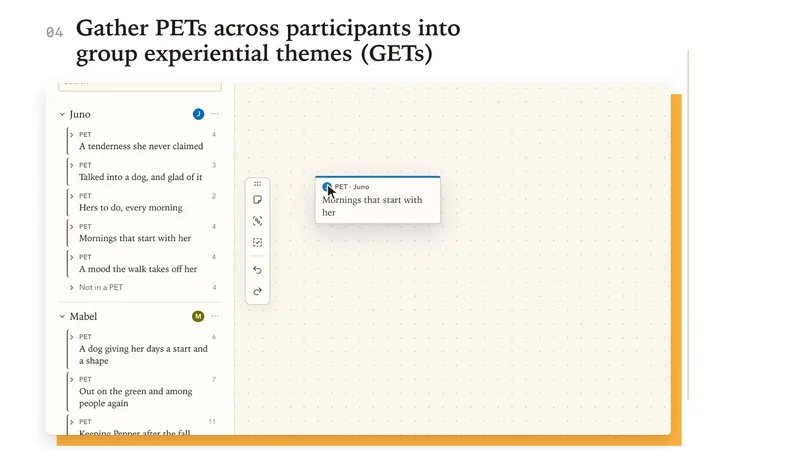
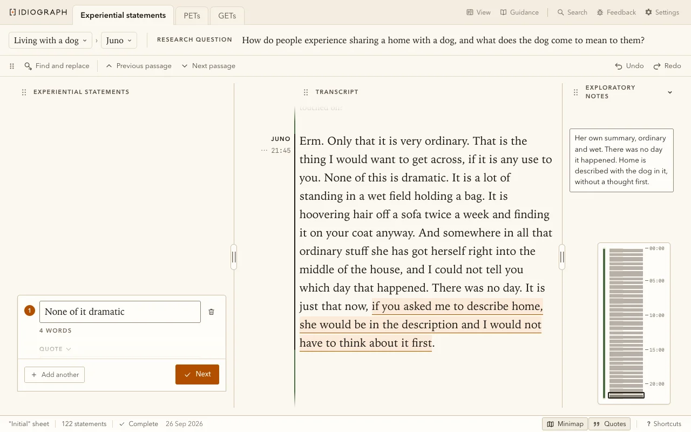
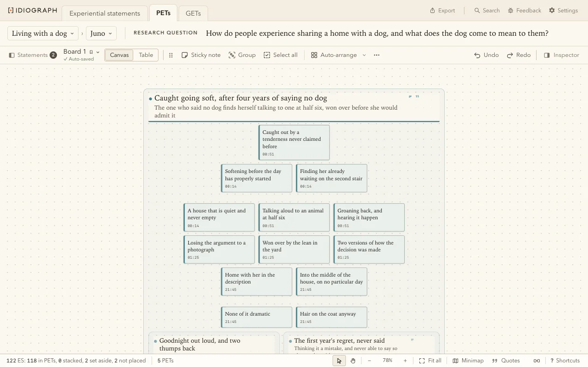
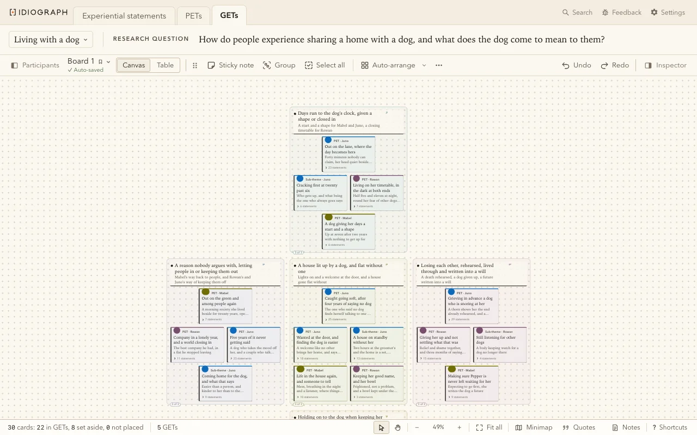

# Idiograph

Idiograph is software for Interpretative Phenomenological Analysis (IPA) and reflexive thematic
analysis (RTA). It is for researchers who analyse their own interviews. It runs on your own Mac, Windows or Linux computer.

- Free
- Open source
- No cloud
- Flexible

When you make a project, you choose its method:

- **IPA** has three screens. Experiential statements shows the transcript a passage at a time, with
  your statements, quotes and notes. PETs and GETs group them into themes.
- **Longitudinal IPA** adds PETs at each timepoint, LPETs, LGETs and Trajectories.
- **Reflexive thematic analysis** follows Braun and Clarke. Its screens are Coding, the Code list and
  Themes.

The pictures show the demo, which was made with AI. They show the app, not how to do IPA.

> ⚠️ This is an early preview, a proof of concept to explore what software for IPA can be. It has not been fully tested or reviewed, so please don't rely on it for anything important: your data could be damaged or lost, so keep copies of your work. It is not yet a replacement for the software you use day to day. Tell me what you think with the bug button or by email. Please keep it to yourself for now: don't share it or post about it.

## Three principles

1. **Human first, AI assisted.** The analyst makes every decision. The AI suggests statements, codes or titles, and you weigh each one: take it, change it or ignore it. It is always the assistant and never the author.

2. **Your files, your machine.** Idiograph writes into the Excel workbook you already use, so your supervisor can read the table. It is built for GDPR. Participant data stays on your computer unless you send a passage to an AI model. There is no account and no subscription. The AI features run on your own key or a local model.

3. **Flexible.** The defaults follow each method's key literature. If you work differently, you can change them in a project's settings.

## Which file do I need?

| Your computer | The file |
| --- | --- |
| Mac with Apple Silicon (M1 or later) | [Idiograph.dmg](https://github.com/Pharkie/idiograph/releases/latest/download/Idiograph.dmg) |
| Windows | [Idiograph-Setup.exe](https://github.com/Pharkie/idiograph/releases/latest/download/Idiograph-Setup.exe) |
| Linux: Ubuntu or Debian | [Idiograph-amd64.deb](https://github.com/Pharkie/idiograph/releases/latest/download/Idiograph-amd64.deb) |
| Linux: any other | [Idiograph-x86_64.AppImage](https://github.com/Pharkie/idiograph/releases/latest/download/Idiograph-x86_64.AppImage) |

Each link gets the newest version, which updates itself.

### Mac

Open `Idiograph.dmg` and drag Idiograph to Applications. macOS says it cannot check the unsigned app. Open it from System Settings, Privacy and Security, Open Anyway. You only do this once.

### Windows

Run `Idiograph-Setup.exe`. Windows says it protected your PC, because the installer is unsigned. Click
More info, then Run anyway. You only do this once.

### Linux

Make `Idiograph-x86_64.AppImage` executable and run it. Ubuntu 24.04 needs `libfuse2t64` for that.
Ubuntu, Debian and Mint can install `Idiograph-amd64.deb` instead, which does not update itself.

### From source

To work on the app, clone it and install Python 3.11 or later. Then double-click `run.command` on a
Mac or `run.bat` on Windows, or run `./run.sh` on Linux. On Windows, tick "Add python.exe to PATH".

## First run

Four demo projects let you try the app. Their interviews are invented and were made with AI. They are
Living with a dog (IPA and RTA), First year on an allotment (longitudinal IPA) and Working from home
(RTA). Reset demo puts each one back as it was.

A project is a folder of participants' folders. Open project opens one you have. New project
sets one up with its folder, name, question and method, then you add transcripts on its page.

## Your transcript

A participant's folder holds an Excel workbook with three columns, Name, Timestamp and Transcript, and
one passage per row, as in `template/Transcript template.xlsx`. If a VTT, SRT, text, Word, CSV or Excel
file is in its `Source` folder, Idiograph offers to "make a workbook" from it.

## AI

The AI features are off until you turn them on in Settings. They suggest statements, codes and
titles, and they change nothing by themselves. They run on your own key, or free with Ollama or LM Studio on your computer. An AI agent can work on a project through the command line or Claude Desktop
once the project's settings allow it. It sends what it reads to its provider.
[docs/agents.md](docs/agents.md) is its guide.

## Privacy

Idiograph's page loads nothing from the internet. Only two things leave your computer, and only when you
press a control. With the AI switch on, an AI control sends its prompt to your chosen provider, and a
local model sends none. The bug in each top bar sends a feedback
note, which carries your words, the app's version, your system, the screen it came from and the time,
and nothing from your projects. Once a day Idiograph asks GitHub for a newer version. GitHub sees your
internet address and version number, not your work. When you press Download on a demo's player, it fetches the recordings from GitHub. Settings asks Anthropic which models a stored key can use. It sends nothing of yours.

## Contributing

Pull requests are welcome under the same licence. GitHub runs the suite on each, as does
`.venv/bin/python tests/test_idiograph.py --train`.

The [manual](docs/manual.md) is for when you are stuck. The [internals](docs/internals.md) say how it runs.

## Licence and support

Idiograph's licence is the GNU Affero General Public License version 3. It is in `LICENSE`. Two terms of its
section 7 and the third-party software are in `NOTICE.md`. The demo's recordings are the one exception.
They are AI voices made with Google Gemini. Their licence is in `packaging/recording/LICENSE-audio.md`.
Pictures: Open Peeps (Pablo Stanley), Notionists (Zoish), Shapes (DiceBear).
If it helps your work, please consider buying me a coffee. A GitHub star also helps others find it.

