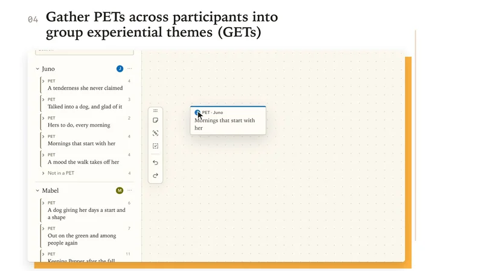
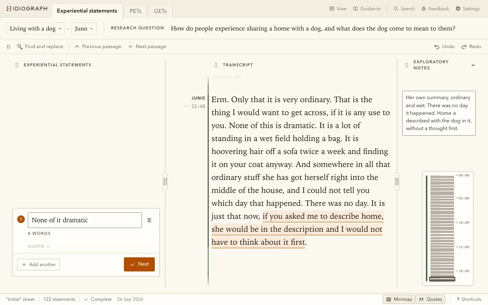
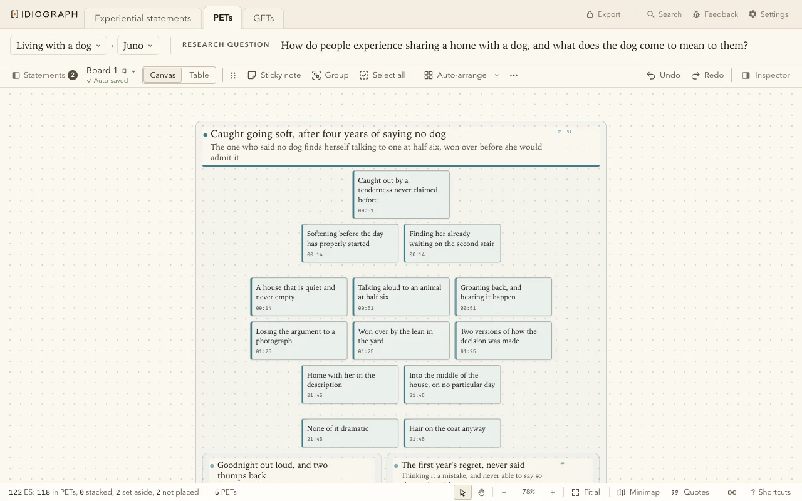
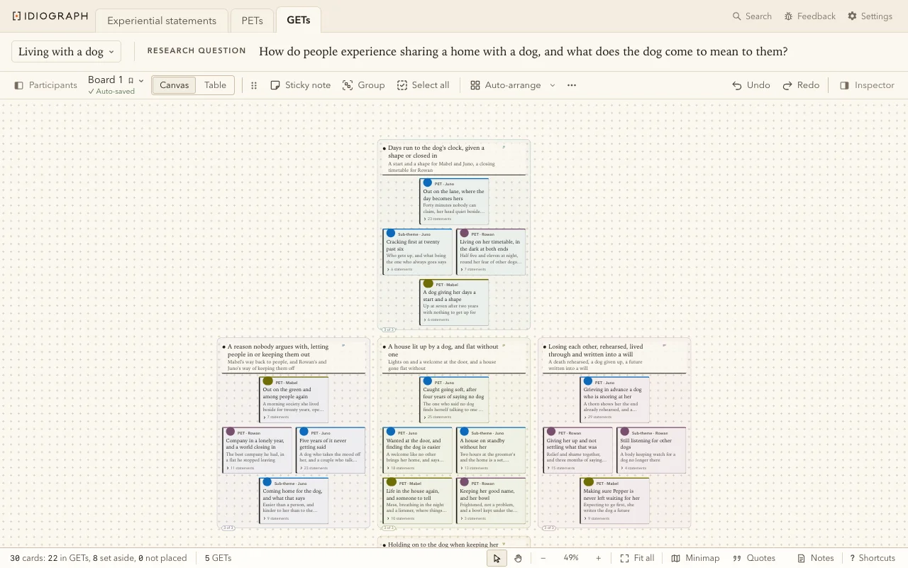

# Idiograph

Idiograph is an app for Interpretative Phenomenological Analysis (IPA) and reflexive thematic analysis,
for researchers who analyse their interviews themselves and want a place made for the method. It runs
on your own computer, a Mac, Windows or Linux.

- Free
- Open source
- Flexible
- No cloud

An IPA project has three screens: Experiential statements, a transcript read a passage at a time with
its statements, quotes and exploratory notes, PETs, one participant's statements grouped into personal
experiential themes, and GETs, every participant's PETs gathered into group experiential themes. A thematic analysis project follows Braun and Clarke: Coding, a Code
list shared by every participant, and Themes.

Two more apps share its code: Sift screens a systematic review's records, by PRISMA 2020, and Trace
checks each claim a manuscript makes against its reference.

The pictures show the demo's invented interviews.

> ⚠️ This is an early preview, a proof of concept to explore what software for IPA and thematic analysis can be. It has not been fully tested or reviewed, so please don't rely on it for anything important: your data could be damaged or lost, so keep copies of your work. It is not yet a replacement for the software you use day to day. Tell me what you think with the bug button or by email. Please keep it to yourself for now: don't share it or post about it.

## Three principles

1. **Human first, AI assisted.** The analyst makes every decision. The AI suggests a statement or three titles, each to be weighed, taken, changed or ignored. It is always the assistant, never the author.

2. **Your files, your machine.** It writes into the Excel workbook you already use, the table supervisors read, always current, beside plain files any tool opens. Privacy first and built for GDPR: participant data never leaves your machine unless you send a passage to an AI model. No account, no subscription. The AI features are the one running cost, pay as you go on your own key, or none at all with a local model.

3. **IPA by the book.** Built on the method's phenomenological, hermeneutic and idiographic ground, every default set by its key literature: Smith, Flowers and Larkin's steps, vocabulary and tables, one participant in depth before the next. Personal habits are settings, never defaults.

## Which file do I need?

| Your computer | The file |
| --- | --- |
| Mac with Apple Silicon (M1 or later) | [Idiograph.dmg](https://github.com/Pharkie/idiograph/releases/latest/download/Idiograph.dmg) |
| Windows | [Idiograph-Setup.exe](https://github.com/Pharkie/idiograph/releases/latest/download/Idiograph-Setup.exe) |
| Linux: Ubuntu or Debian | [Idiograph-amd64.deb](https://github.com/Pharkie/idiograph/releases/latest/download/Idiograph-amd64.deb) |
| Linux: any other | [Idiograph-x86_64.AppImage](https://github.com/Pharkie/idiograph/releases/latest/download/Idiograph-x86_64.AppImage) |

Each link gets the newest version, which updates itself.

### Mac

Open `Idiograph.dmg` and drag Idiograph to Applications. Unsigned, macOS says it cannot check the app,
and System Settings, Privacy and Security, Open Anyway opens it, once.

### Windows

Run `Idiograph-Setup.exe`. Unsigned, Windows says it protected your PC, and More info, Run anyway runs
it, once.

### Linux

Make `Idiograph-x86_64.AppImage` executable and run it. Ubuntu 24.04 needs `libfuse2t64` for that.
Ubuntu, Debian and Mint can install `Idiograph-amd64.deb` instead, which does not update itself.

### From source

For work on the app: clone it, install Python 3.11 or later, then double-click `run.command` on a
Mac, `run.bat` on Windows (with "Add python.exe to PATH" ticked in Python's installer), or run
`./run.sh` on Linux.

## First run

The demo, Living with a dog, is a finished IPA project, so
everything can be tried on nobody's words, and Reset demo puts it back. A project is a folder of
participants' folders: Open project folder, on Home, takes one, and New project makes one from your
transcripts.

## Your transcript

A participant's folder holds an Excel workbook with three columns, Name, Timestamp and Transcript, one
passage per row, as in `template/Transcript template.xlsx`. A VTT or SRT file, plain text, a Word, CSV
or Excel file in its `Source` folder is offered with "make a workbook".

## AI

The AI features are off until you turn them on in Settings. They suggest statements for a
passage, and on the canvas a grouping, titles and review questions, and change nothing by themselves.
They run on your own key, or free on your own computer with Ollama or LM Studio. An AI agent can work on a project through the command line or Claude Desktop once Settings,
Projects allows it, sending what it reads to its provider. [docs/agents.md](docs/agents.md) is its guide.

## Privacy

Idiograph's page loads nothing from the internet. Three
things leave, each only when you press a
control: with the AI switch on, the prompt an AI control builds from a passage, a board, a
screening's record or a reference's PDF, sent to your chosen provider, none with a local model, Sift's
searches, lookups and Zotero syncs, sent to your chosen databases, OpenAlex, Unpaywall and Zotero, and a feedback note, sent with the bug in each top bar, which carries your words, the app's version, your system, the screen it came from and the
time, and nothing from your projects. Once a day Idiograph asks GitHub for a newer version. GitHub sees
your internet address and version number, never your work. Settings asks Anthropic which models a
stored key can use, sending nothing of yours.

## Contributing

Pull requests are welcome under the same licence. GitHub runs the suite on each, and after the first
run so does `.venv/bin/python tests/test_idiograph.py --train`.

The [manual](docs/manual.md) describes every screen, the [internals](docs/internals.md) how it runs.

## Licence and support

Idiograph, Sift and Trace are under the GNU Affero General Public License version 3, in `LICENSE`,
with two terms of its section 7 and the third-party software in `NOTICE.md`. If it helps your work,
please consider buying me a coffee, and a GitHub star helps others find it.

